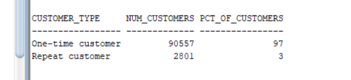
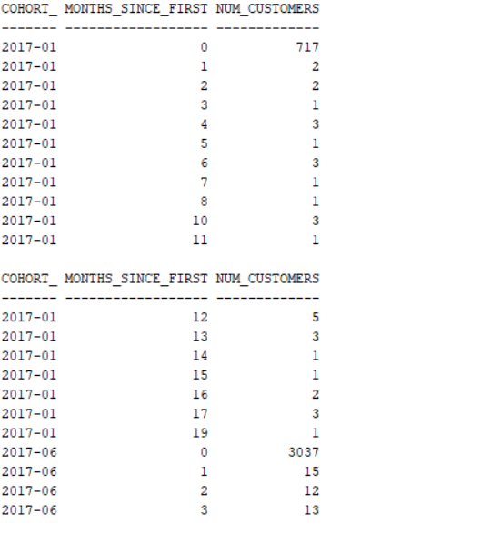
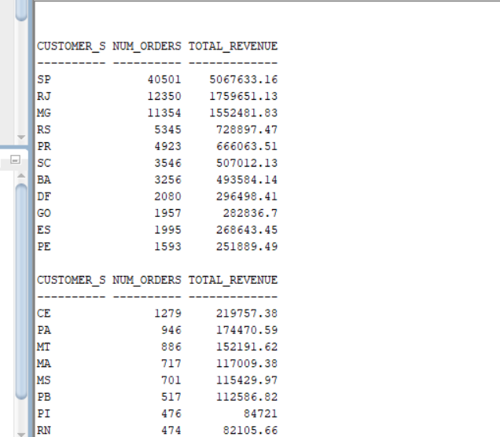
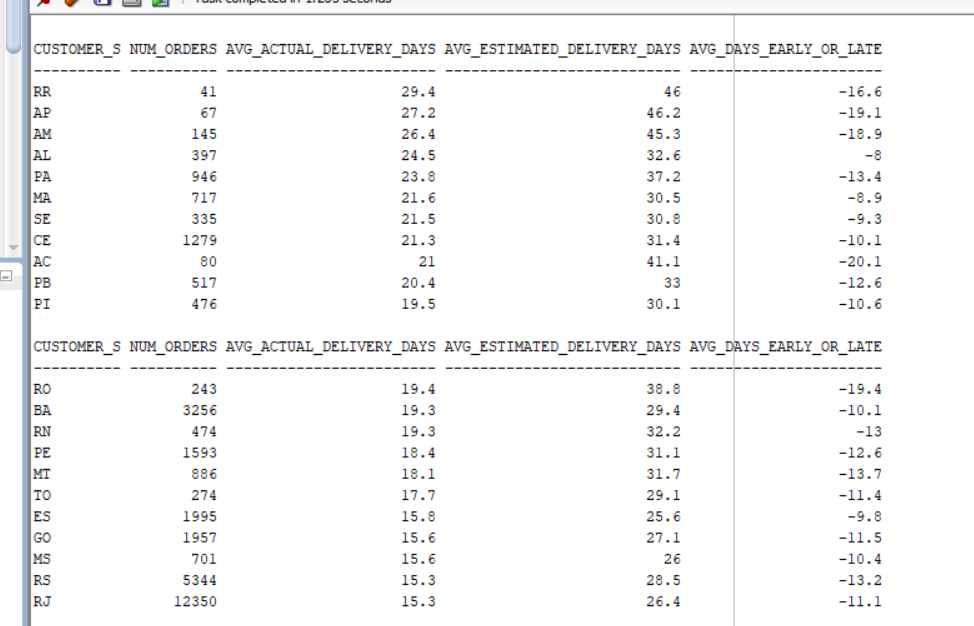

# Olist E-Commerce SQL Analysis

## Overview
An end-to-end SQL analysis of 99,441 orders from Olist, a Brazilian 
e-commerce marketplace, covering September 2016 to August 2018. 
The project uses Oracle SQL to explore revenue trends, geographic 
distribution, seller performance, delivery reliability, customer 
reviews, and customer retention behavior.

**Skills used:** joins, CTEs, window functions (LAG, DENSE_RANK, NTILE), RFM segmentation, cohort retention analysis, data quality checks

**Dataset:** [Brazilian E-Commerce Public Dataset by Olist](https://www.kaggle.com/datasets/olistbr/brazilian-ecommerce) (Kaggle)
**Tool:** Oracle SQL (SQL Developer)
**Tables:** 9 relational tables, 1.4M+ rows loaded

## Key Findings & Recommendations

1. **Only 3% of customers make a second purchase**, and cohort 
   analysis shows 99%+ drop-off right after month 0. This is the 
   biggest growth opportunity. 
   *Recommendation: launch follow-up offers and loyalty rewards.*
2. **São Paulo state drives ~40% of total revenue**, so the business 
   is heavily concentrated in Brazil's Southeast. 
   *Recommendation: invest in other states to reduce risk.*
3. **Delivery estimates are padded.** Every state delivers earlier 
   than promised. 
   *Recommendation: tighten delivery promises.*
4. **bed_bath_table** is a top-3 revenue category but also among the 
   lowest-rated. 
   *Recommendation: check seller quality in this category.*
5. **Credit card (78% of payments)** is the only method used with 
   installments, so it is a key purchasing enabler. 
   *Recommendation: keep installment options prominent.*

Full write-up: [executive_summary.txt](executive_summary.txt) and [insights.txt](insights.txt)

### Sample Results

**Repeat customer rate**

**Cohort retention**

**Revenue by state**

**Delivery time vs. estimate by state**

## Business Questions Answered
13 SQL queries, from basic aggregation to advanced window functions:

**Basic:** monthly revenue trends, top categories by revenue, revenue 
by state/city, payment method distribution

**Intermediate:** repeat customer rate, seller performance, delivery 
time vs. estimate by state, categories with worst review scores

**Advanced:** month-over-month growth (LAG), top products per category 
(DENSE_RANK), RFM customer segmentation (NTILE), cumulative revenue & 
moving averages, cohort retention analysis

## Database Schema
See [er_diagram.png](er_diagram.png) for the entity-relationship diagram.

Tables: customers, orders, order_items, order_payments, order_reviews, 
products, sellers, geolocation, and category_translation.

## Data Quality Notes
- Filtered all analysis to `order_status = 'delivered'` (96,478 orders, 
  97% of total) to reflect completed transactions.
- No duplicate order IDs found.
- 2,965 orders have no delivery date (not yet delivered/cancelled).
- `order_delivered_customer_date` was imported as text; converted using 
  `TO_DATE()` where needed for date calculations.
- ~2,300 review rows were skipped during import due to malformed text 
  in comment fields; this affects only comment text, not review scores.

## Files in This Repo
- `00_data_quality_checks.sql` to `13_cohort_retention.sql`: all SQL queries, numbered in order
- `.png` files: screenshots of query results
- `er_diagram.png`: database schema diagram
- `insights.txt`: detailed notes per question
- `executive_summary.txt`: top findings and recommendations

## Author
SHAMNAS MUSTHAFA | shamnasmusthafa12@gmail.com
